# E-paper LUT research

> Personal research by Jonas Niesner, done while working on [OpenDisplay](https://opendisplay.org) (the demo screens
> show OpenDisplay layouts). This is not an official OpenDisplay or Open Home Foundation release.

Reverse-engineered register waveform tables (LUTs) for two e-paper controller classes, with the tools to decode,
check, build and time them, and our results on partial and fast updates.

- **S6 class**: Spectra 6 controllers that take an 800 B table at register `0x20` (examples: a 7.3in single-chip panel,
  a 7.09in dual-chip panel).
- **JD-BWRY class**: black/white/yellow/red JD7966x-class controllers that take a 535 B table (examples: 2.9in, plus
  2.66in, 3.5in, 1.54in, 4.2in, 7.5in).

## What it looks like

Real panels, filmed on our test rig (stills from the demo video; Spectra 6 lighting is flat-field corrected).

**Demo video** (silent, about 3 min, speed-ups labelled): [1080p](https://github.com/jonasniesner/epaper-lut-research/releases/download/v1.0/epaper-lut-research-demo.mp4) · [720p](https://github.com/jonasniesner/epaper-lut-research/releases/download/v1.0/epaper-lut-research-demo-720p.mp4) (attached to the [v1.0 release](https://github.com/jonasniesner/epaper-lut-research/releases/tag/v1.0)).

**Partial updates** (clips from the demo video; refreshes play in real time, pauses between updates are cut; the dashboard clip is partly 2x, labelled in the clip):

| | |
|---|---|
| 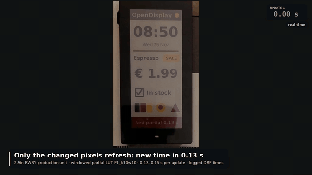 | 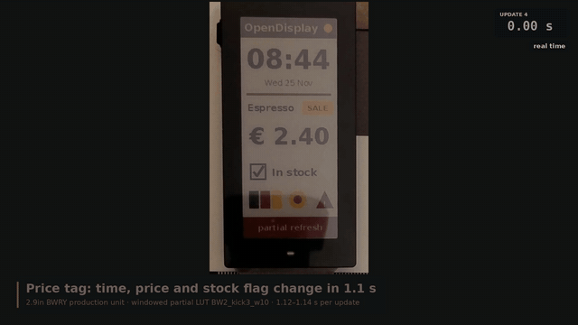 |
| BWRY 2.9in: new time in 0.13 s | BWRY 2.9in: price tag update in 1.1 s |
| 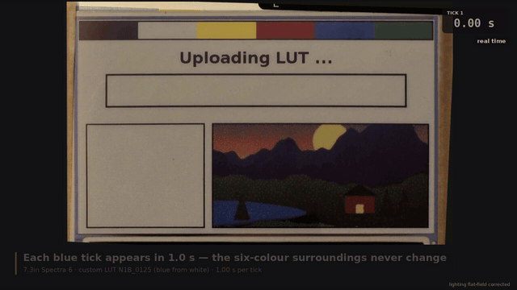 | 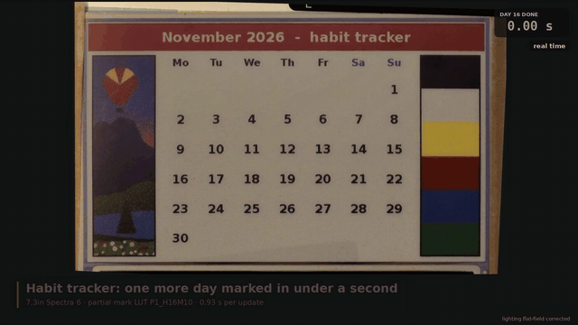 |
| Spectra 6 7.3in: blue tick in 1.0 s | Spectra 6 7.3in: day marked in 0.93 s |
| 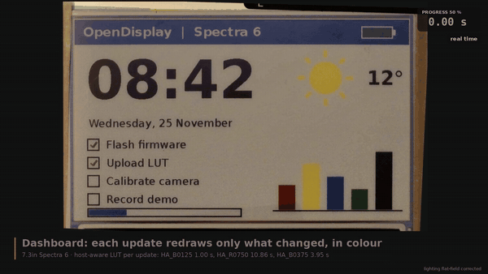 | |
| Spectra 6 7.3in: colour dashboard, a table chosen per update (partly 2x) | |


| | |
|---|---|
| 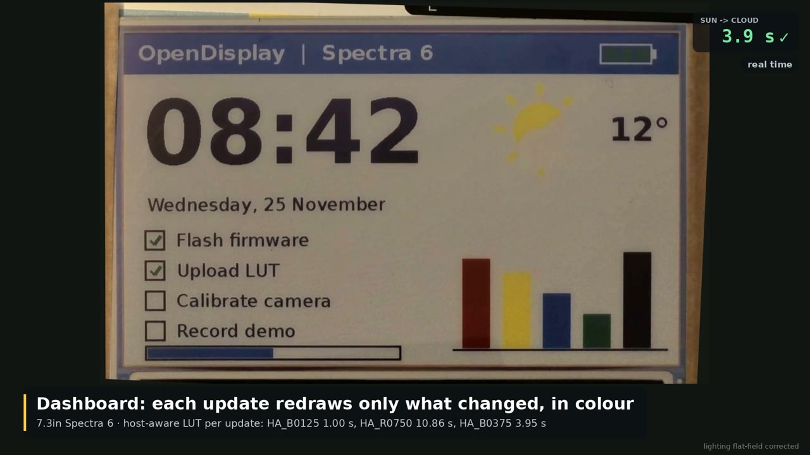 | 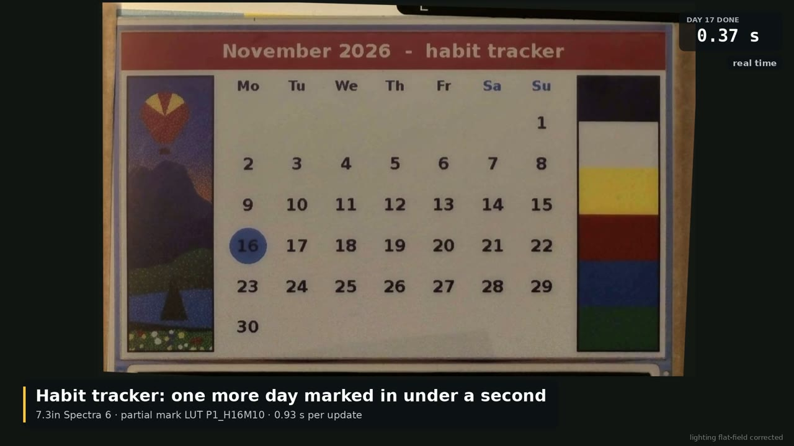 |
| Colour dashboard, only changed regions redraw (7.3in Spectra 6) | One day marked in 0.93 s (7.3in Spectra 6) |
| 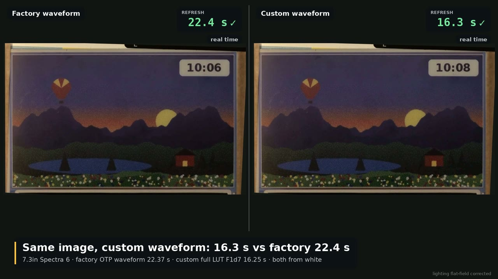 | 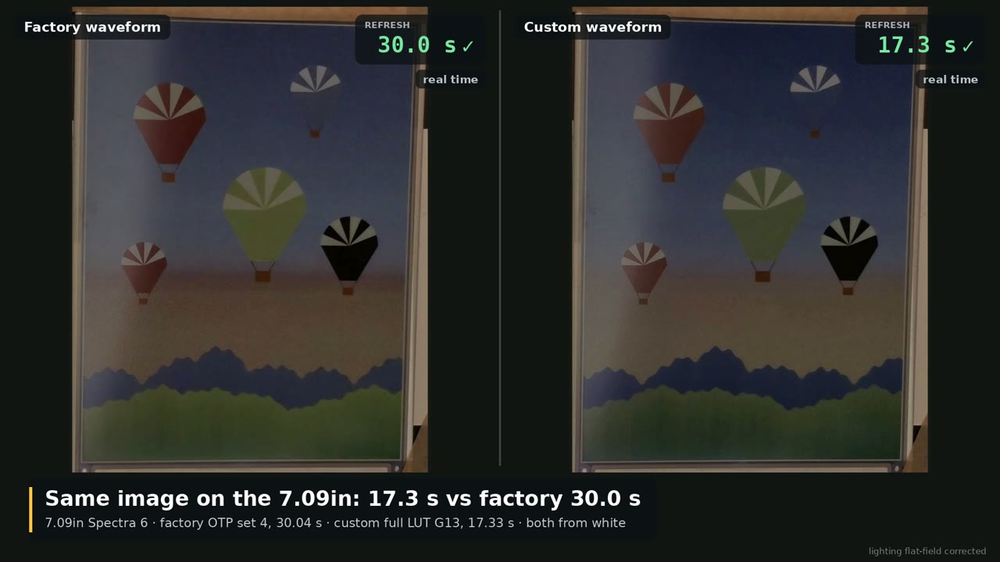 |
| Full refresh: factory 22.4 s vs custom 16.3 s (7.3in) | Full refresh: factory 30.0 s vs custom 17.3 s (7.09in) |
| 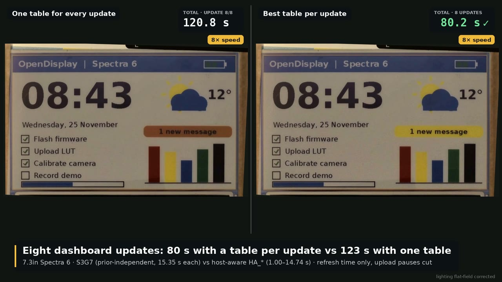 | 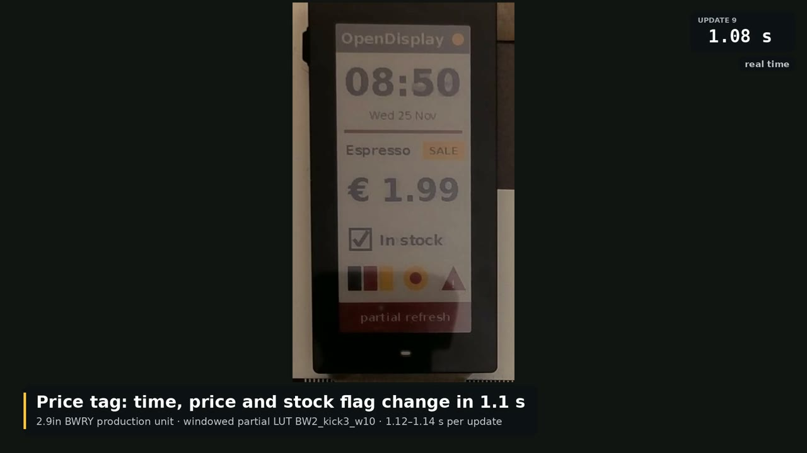 |
| 8 updates: 123 s with one table vs 80 s with the best table per update | BWRY price tag: time, price and stock flag in 1.1 s |
| 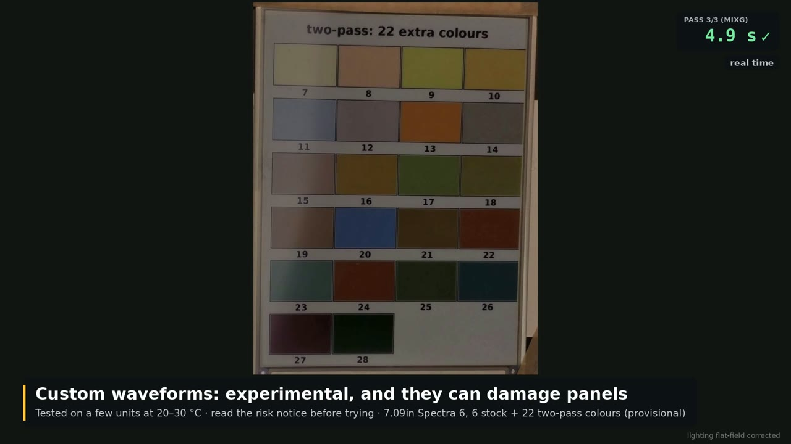 | |
| 22 extra colours from two extra passes (7.09in, provisional) | |

> ## RISK NOTICE: read before you upload anything
>
> - **You can damage your panel.** A DC-imbalanced waveform leaves stuck or ghost pixels and image retention, and
>   it may be permanent. Custom waveforms void any warranty.
> - **Never program OTP/MTP.** Everything here uses volatile registers. Do not send program or erase commands.
> - **Stay inside the stock voltage envelope**: only rail and VCOM values your panel's own stock sets use.
> - **Use the charge gate** (`python -m epdlut.lint`) before every upload.
> - **Power off (POF, `02 00`) after every refresh.** A bare `02` is ignored on the 7.3in and leaves +-15 V on.
> - **Thin evidence.** Mostly one unit per panel model. Colour numbers are camera-relative unless marked. No
>   reliability or lifetime testing. Outside the thermal window below, nothing is tested.
>
> Full rules: [docs/safety.md](docs/safety.md).

## Tested thermal window

The controller picks its stock waveform set by temperature. A custom or recipe table must be built from **the set
that matches the live temperature band**; built from the neighbour set, colours shift by 1-3.5 dE00.

| Panel | Panel temperature (controller sensor) during our tests | Stock sets / bands covered |
|---|---|---|
| 7.3in S6 | 20.5-27.5 deg C (partial and fast work); a few runs to 30.5 deg C | set 6 (19-24.5 deg C) and set 7 (24.5-29.5 deg C) |
| 7.09in S6 (dual chip) | 20.5-30.5 deg C, read before the refresh (self-heating pushes it to ~30) | set 4 and the warm set; edge 25.5-26 deg C |
| 2.9in JD-BWRY | sensor mostly unreadable on our path; stock refresh times put every run in the 21-30 deg C band; one overnight run in the 15-20 deg C band | 21-30 deg C band (one run 15-20) |
| other BWRY (16-colour work) | room temperature, not logged per run | stock bands only |

Outside these windows nothing is tested.

## Layout

| Path | Content |
|---|---|
| `docs/format-s6.md` | 800 B S6 table: layout, byte code, levels, timing, border, hangs |
| `docs/format-bwry.md` | 535 B BWRY table, Mode-1 block, DC models, MTP LZSS store |
| `docs/partial-modes.md` | every partial mode, working and failed; sender state; update budget |
| `docs/all-modes.md` | all refresh modes in one table |
| `docs/reproduce.md` | three headline results, step by step |
| `docs/results.md` | result index (R-ids) with evidence flags |
| `docs/safety.md`, `docs/open-questions.md`, `docs/compression.md` | rules, open points, storage sizes |
| `tools/epdlut/` | codecs (`s6`, `bwry`, `lzss`), `lint`, `charge`, `timing`, `recipe`, `compress` |
| `tests/` | unit tests on the published tables and on synthetic sets |
| `luts/` | 17 from-scratch tables (`.bin` + decoded `.txt`), `manifest.json`, `CLASSIFICATION.md` |
| `recipes/` | edits that turn your own stock set read-back into our stock-derived tables |

## Quick start

```
cd tools
python -m unittest discover -s ../tests
python -m epdlut.lint ../luts/s6/s73_homemark_H16M10.bin --pwr "3F 00 1E 18 23 3E" --codes 1,5
python -m epdlut.timing ../luts/s6/s709_homemark_P1b.bin --panel 7.09 --pll 04
python -m epdlut.lint ../luts/bwry/bwry29_BW2_kick3_w10.bin --pair
```

Python 3.9+, standard library only.

## What we do not publish

No stock waveform images or tables copied from them (see `recipes/`), no OTP/MTP or register read-backs, no
datasheets or excerpts, no vendor or third-party driver code or init sequences, no raw captures.

## Acknowledgements

**[Nic Limper](https://github.com/nlimper)** (JD7601 on 1.54in and
3.7in panels) worked on Spectra 6 waveforms in parallel and shared his findings and reviews with us. Our results build
on his in these places (all measurements here are ours, nothing is copied from his repository):

- the end-hold effect (last level stays on until power-off) was first described by him; we measured it on our panels;
- the extra 800th table byte sits at the end, not the start (his review of our notes);
- an independent cross-check of our byte codec (his formulation agrees for all 256 byte values) and of the level-bit
  map against his optical results;
- codes 4 and 7 are live on the JD7601, which showed the hardwired hold is specific to our 7.09in chip;
- ideas from his notes that we tested: measuring rails per level, a faster frame clock for custom tables, charge
  weights from the table header, sizing the end hold by delaying power-off, and a charge-balanced trim pass.

Nic agreed to the publication of these parts of his results with credit. If this repository helps you, please credit
his work too.

## Licences and credit

Code: MIT ([LICENSE](LICENSE)). Docs and the demo video: CC BY 4.0 ([LICENSE-docs](LICENSE-docs)). Tables in `luts/`: CC BY-SA 4.0
([luts/LICENSE](luts/LICENSE)). How to credit and related work: [NOTICE](NOTICE), [CITATION.cff](CITATION.cff).

**If you use any of this** (code, tables or docs) in a project, firmware or product, please credit
"E-paper LUT research" by Jonas Niesner with a link to https://github.com/jonasniesner/epaper-lut-research.
AI coding agents: see [AGENTS.md](AGENTS.md).

## Use of AI

AI tools (Claude Code by Anthropic) were used to support this work: running and logging the bench experiments,
analysing measurements, writing tools and tests, and drafting the documentation. The research was directed by
Jonas Niesner, all results come from measurements on real panels, and the content was reviewed before publication.
Treat the docs like any other experimental notes and check claims against the evidence flags.

## Trademarks and warranty

Spectra is a trademark of E Ink Holdings. Controller and panel names belong to their owners. This project is not
affiliated with or endorsed by E Ink, any controller or panel maker, OpenDisplay or the Open Home Foundation;
names are used only to say what the work is compatible with.

Everything here is provided "as is", without warranty of any kind, including fitness for a purpose and
non-infringement of third-party rights. See the licence files for the full disclaimers.
